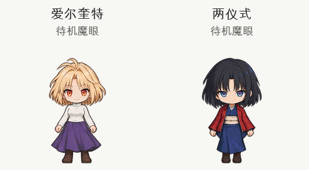

# Codex 桌宠素材

Saber、爱尔奎特与两仪式的 Q 版桌宠素材。

| 角色 | 素材目录 | 说明 |
| --- | --- | --- |
| Saber | [codex-pet](codex-pet/) | 原有 Saber 素材 |
| 爱尔奎特 | [pets/arcueid](pets/arcueid/) | 赤金色魔眼，待机时持续发光 |
| 两仪式 | [pets/ryougi-shiki](pets/ryougi-shiki/) | 蓝紫虹彩直死之魔眼，待机时持续发光 |

## 爱尔奎特与两仪式 · 魔眼持续版

魔眼在待机阶段保持开启，并保留轻微呼吸和眨眼。原来的跳跃动画已改为站在原地发动魔眼；移动、挥手、失落、等待、工作、检查和十六方向视线均保留。

每个角色目录提供：

- `spritesheet.png`：正式透明精灵图，适合导入。
- `spritesheet.webp`：无损 WebP 备份。
- `pet.json`：角色名称、说明与本地素材路径。
- `idle-magic.gif`：待机魔眼预览。
- `preview.gif` / `preview.mp4`：全部动作预览。
- `README.md`：对应角色说明。

精灵图规格为 1536 × 2288 像素，8 列 × 11 行，每格 192 × 208，共 73 个有效姿态。保留格式所需的原跳跃行，但该行显示站立魔眼特效，角色不会离地。

## 使用

下载角色目录中的 `spritesheet.png`，在应用的自定义桌宠导入入口添加。`pet.json` 可供支持本地宠物目录的版本使用；具体入口以当前应用版本为准。

角色和动作由 imagegen 生成、编辑，再完成透明边缘清理、帧提取、尺度与落脚位置统一。发布前检查必需帧、空白格、透明背景、动作连通性、站立基线和精灵图格式。
